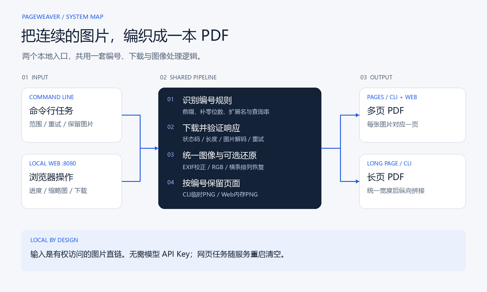

# PageWeaver

**从一张带编号的图片直链，得到按顺序排好的 PDF。**

用于归档扫描页、课程讲义等连续图片资料：推导后续页的地址，校验图片，处理尺寸与方向，最后导出多页 PDF；命令行还可保留 PNG 或拼成长页。提供本地网页与 CLI，共用同一套下载逻辑，无需模型 Key 和数据库。

[安装](#安装) · [第一次下载](#第一次下载先预览再保存) · [网页入口](#使用本地网页) · [参数](#参数参考) · [处理原理](#从一条链接推导整组图片) · [常见问题](#常见问题)

## 安装

准备 Python 3.11+。在 Windows PowerShell 中运行：

```powershell
git clone https://github.com/kayaduster607-jpg/pageweaver.git
cd pageweaver
python -m venv .venv
.\.venv\Scripts\python.exe -m pip install -r requirements.txt
```

下文命令都从项目根目录执行。macOS / Linux 将虚拟环境 Python 路径替换为 `.venv/bin/python`。

## 第一次下载：先预览，再保存

输入必须是**直接打开后显示图片的 HTTP(S) 地址**，文件名末尾带页码，例如 `page_0031.webp`。文章页、阅读器页和现成 PDF 链接不适用。

### 不联网检查编号

```powershell
.\.venv\Scripts\python.exe image_url_to_pdf.py "https://example.com/book/page_0031.webp" --dry-run --descramble none
```

该命令只推导地址，应打印从 `page_0001.webp` 到 `page_0005.webp` 的五条链接，不创建 PDF。**默认起点是 1，样例里的 0031 只用于识别编号宽度。** 要从第 31 张开始，加 `--start 31`。

### 替换为真实图片链接

以下 example.com 不提供这些图片。把整条 URL 换成自己有权访问的来源，确认范围后下载：

```powershell
.\.venv\Scripts\python.exe image_url_to_pdf.py "https://example.com/book/page_0001.webp" --start 1 --end 20 --descramble none --keep-images -o output/book.pdf
```

正常完成后检查：

```text
output/
├── book.pdf          # 一张图片对应一页
└── book_images/      # 保留下来的处理后 PNG
```

现有文件默认不覆盖，最终名称以终端打印为准。打开 PDF 核对页数、顺序和清晰度；指定结束页后提前停止会报告失败，不能只看目录里出现 PDF。

### 按需要换输出形式

| 目的 | 在下载命令中使用 |
| --- | --- |
| 从指定页开始 | `--start 31` |
| 只保存多页 PDF | 去掉 `--keep-images` |
| 拼成一张连续长页 | `--pdf-mode long --long-width 1000` |
| 普通图片，关闭横条还原 | `--descramble none` |
| 来源需要 Referer | `--referer "https://example.com/reader/"`，替换为真实来源页 |

长页需要大画布，内存占用高于逐页 PDF；更高 DPI 不会增加原图像素。

## 使用本地网页

```powershell
.\.venv\Scripts\python.exe image_to_pdf_server.py
```

打开 [http://127.0.0.1:8080](http://127.0.0.1:8080)，粘贴同类图片直链、填写起始编号，点击“开始抓取”。观察缩略图和已获取张数，结束后点击“下载 PDF”，浏览器保存为 `comic_<task_id>.pdf`。

网页当前提供多页 PDF，表单没有结束页和长页参数；需要精确范围或长页时使用 CLI。任务只在进程内存中保存，重启后消失。出现“含错误 / 可能不完整”时，下载内容只是此前已成功获取的连续页面。

## 下载与图像处理



核心函数位于 [image_url_to_pdf.py](image_url_to_pdf.py)，网页入口复用 URL 解析、抓取和横条还原逻辑。下载按页顺序执行；没有并行下载、持久化队列或断点续传。图示提供 [SVG](docs/assets/pageweaver-flow.svg) 和 [绘图源码](tools/generate_architecture.py)。


## 参数参考

| 参数 | 默认值 | 作用 |
| --- | --- | --- |
| `url` | 必填，自测除外 | 任意一张符合编号规则的图片直链 |
| `-o` / `--output` | 自动生成 | 指定PDF路径；扩展名会统一为 `.pdf` |
| `--start` | `1` | 从哪个编号开始，允许0；不会自动采用样例图的编号 |
| `--end` | 未指定 | 最后编号，包含该页 |
| `--max-pages` | `2000` | 最多成功下载的图片数；0表示不设此上限 |
| `--descramble` | `auto` | `auto`、`jm`、`none` 三种横条还原模式 |
| `--jm-aid` | 自动识别 | 强制JM模式时可手动提供章节ID |
| `--scramble-id` | `220980` | 横条排列规则的起始阈值 |
| `--pdf-mode` | `pages` | `pages`多页，`long`单张长页 |
| `--dpi` | `150` | Pillow导出与长页的基础DPI；不会增加图像像素 |
| `--long-width` | 源图最大宽度 | 长页统一宽度，单位像素 |
| `--max-long-pixels` | `300000000` | 长页画布像素上限；0关闭这项检查 |
| `--timeout` | `20.0` | Requests网络等待参数，单位秒 |
| `--retries` | `3` | 首次请求以外的重试次数；默认最多4次尝试 |
| `--delay` | `0.05` | 每张成功下载后的等待，单位秒 |
| `--referer` | 按模式选择 | 自定义来源页请求头 |
| `--user-agent` | 内置值 | 自定义User-Agent |
| `--header` | 空列表 | 可重复传入 `Name: value`，后写入的值可覆盖同名头 |
| `--keep-images` | 关闭 | 在PDF旁保留处理后的PNG目录 |
| `--overwrite` | 关闭 | 允许覆盖PDF；否则自动选择未占用文件名 |
| `--dry-run` | 关闭 | 打印起始的最多5条地址，不下载 |
| `--self-test` | 关闭 | 使用合成图片执行离线自测 |

没有指定输出路径时，一般保存到 `output/pdf/<目录名>.pdf`；可识别的章节路径则使用章节ID命名。文件名已存在时会增加序号，保留图片目录也会独立选择未占用名称。

`--max-pages`是停止条件，不是完整性证明：达到上限后会合成已经获取的页面，即使指定的结束页更远也不会继续下载。对于已知范围，应使该上限覆盖预期页数，并核对最后的实际页数。


## 从一条链接推导整组图片

`parse_sequence_url()`只接受HTTP(S)地址，解析末尾的“前缀 + 数字 + 扩展名”。例如：

```text
input:     https://example.com/book/page_0031.webp?sig=demo&v=2
prefix:    page_
width:     4
extension: .webp
start=1:   https://example.com/book/page_0001.webp?sig=demo&v=2
start=2:   https://example.com/book/page_0002.webp?sig=demo&v=2
```

`SequencePattern.filename_for()`用数字宽度补零；`url_for()`替换文件名，保留目录、查询串和fragment。保留已有签名参数并不保证新编号的URL也通过服务端校验；若签名按文件路径绑定，仍需来源端提供有效地址。

当前不解析阅读器HTML，不自动查找图片列表，也不推断跨目录、混合扩展名、跳号或随机文件名。给出 `page_0031.webp` 只是提供编号模板，程序默认从1开始；想接着31下载必须明确写 `--start 31`。


## 下载校验与停止规则

`fetch_image()`通过Requests Session复用连接。每张图片要经过以下检查：

1. **HTTP状态。** 404或410作为序列结束信号；其他HTTP错误进入异常处理与重试。
2. **重定向结果。** 最终文件名若是内置的常见404占位图名称，视为不存在。
3. **内容类型。** 文本或HTML响应被视为非图片，不当作正常页面保存。
4. **响应长度。** 有Content-Length且没有Content-Encoding时，比较下载字节数；不完整响应重试。
5. **真实解码。** 由Pillow打开并加载像素，不能完整解码的数据不会成为正常页面。

失败重试的等待依次为1、2、4秒，继续增加时上限为8秒。Requests的timeout约束网络等待，并非严格的整项任务总时长。[Requests超时说明](https://docs.python-requests.org/en/latest/user/quickstart/#timeouts)

| 情况 | 命令行行为 | 网页行为 |
| --- | --- | --- |
| 第一张就不存在或返回非图片 | 失败，不生成PDF | 任务含错误，无有效PDF |
| 未指定结束页，后续出现结束信号 | 正常停止，合成已有页面 | 正常结束，合成已有页面 |
| 指定结束页，但提前遇到结束信号 | 失败，不合成本次PDF | 记录错误，仍可能提供此前连续页面的PDF |
| 网络或解码失败，重试耗尽 | 失败，不合成本次PDF | 记录错误，保留此前连续成功部分 |
| 达到图片数上限 | 停止并合成已有页面 | 记录上限提示，再尝试合成已有页面 |

“自动判断结束”存在边界：登录页、访问限制页也可能返回HTML。因此未知总页数时，非图片响应可能被当成结束；已知范围应指定 `--end`，并核对输出张数。程序不会跳过缺失页继续尝试后面的编号，也不能单凭PDF成功打开证明资料完整。


## 图像归一化与横条还原

### 先统一可合成的图像格式

图片解码后先依据EXIF调整方向，再统一成RGB。RGBA等带透明通道的图片会放到白色背景上，减少透明区域在PDF里变黑的情况。中间结果使用PNG，便于保持页面顺序和继续处理。

这一步不会执行OCR、翻译、自动裁白边或画质增强，生成的PDF主要是图像页面，不自动获得可搜索的文字层。

### 可选的横条排列恢复

部分来源将一页切成若干水平条带，按特定顺序保存。`restore_jm_stripes()`根据条带数重新裁切与排列，并处理图像高度不能整除条带数的余数。它恢复的是像素条带位置，不是文字识别或密码学解密。

当前自动模式根据路径 `/media/photos/<id>/` 提取章节ID，不同时验证站点身份。普通来源恰好使用相似路径时，也可能触发自动规则；这时应使用命令行 `--descramble none`。网页当前未提供关闭开关。

条带数量规则由 `calculate_jm_segment_count()`实现：

| 条件 | 当前计算方式 |
| --- | --- |
| ID小于scramble阈值 | 不还原 |
| ID达到阈值但小于268850 | 使用10条 |
| ID从268850起且小于421926 | MD5派生，使用模10的分支 |
| ID从421926起 | MD5派生，使用模8的分支 |

派生输入为章节ID与图片文件名主干的连接，取MD5十六进制结果最后一个字符的字符码，计算偶数条带数量。这里记录的是现有代码规则；来源改变存储方式后，需要重新验证，不能保证所有带该路径的图片都应套用它。


## 两种PDF布局与资源占用

### 多页模式

`pages`按编号顺序合成，每张图对应一个PDF页面。命令行优先使用img2pdf；缺少该模块时才回退到Pillow。命令行中img2pdf已经安装但转换报错时，不会自动转入Pillow分支。

网页启动时依赖img2pdf包；合成过程中若img2pdf失败，会再尝试Pillow。这与“网页可以不安装img2pdf”是两回事。

多页模式使用img2pdf时，当前函数没有将 `--dpi` 传入布局设置；该参数主要影响Pillow回退和长页导出。整个流程已经将图片解码并转成PNG，因此不宣称“原始JPEG字节原样嵌入”或“任意输入零转换”。[img2pdf项目说明](https://gitlab.mister-muffin.de/josch/img2pdf)

### 长页模式

`long`先选择统一宽度，等比例缩放每页，再依次贴到同一张纵向画布上。为避免PDF单页尺寸过大，保存时会按画布尺寸提高有效DPI，使页面边长不超过代码中的14400点限制。

默认长页上限是3亿像素。仅RGB画布理论上就约需9亿字节，实际峰值还包含解码图、缩放副本和编码缓冲；这不是小内存模式。图片较多时，优先多页PDF，或通过 `--long-width` 缩小宽度。

### 数据保存在哪里

| 数据 | 命令行 | 网页 |
| --- | --- | --- |
| 下载响应 | 每次读取一张完整响应 | 每次读取一张完整响应 |
| 处理后的图片 | 临时PNG；可选择永久保留 | 本次任务的内存PNG |
| 缩略图 | 无 | 内存JPEG，最大300x400 |
| 最终PDF | 输出路径 | 内存字节，通过下载接口发送 |
| 任务记录 | 终端日志 | 进程内字典，无持久化和自动过期清理 |

网页使用StreamingResponse发送已生成的PDF，**不表示图片边下载边编码成PDF，也不表示完整PDF从未进入内存**。当前网页每个任务启动一个线程，没有统一并发上限或取消接口；大量或大型任务应分批处理，结束后重启服务可清空内存状态。


## 网页任务与 API

### 请求顺序

```text
Browser
  -> POST /api/start?url=...&start=1&end=20
  <- task_id + numbering template
  -> GET /api/status/{task_id}
  -> GET /api/thumb/{task_id}/{number}
  -> GET /api/download/{task_id}
```

`POST /api/start`使用**查询参数**，不是JSON请求体。这与当前FastAPI函数签名一致。[FastAPI查询参数说明](https://fastapi.tiangolo.com/tutorial/query-params/)

下面是调用格式示例，真实执行前必须更换图片地址：

```powershell
$imageUrl = [uri]::EscapeDataString("https://example.com/book/page_0001.png")
$task = Invoke-RestMethod -Method Post -Uri "http://127.0.0.1:8080/api/start?url=$imageUrl&start=1&end=20"
Invoke-RestMethod -Uri "http://127.0.0.1:8080/api/status/$($task.task_id)"
```

启动成功的响应示意：

```json
{
  "task_id": "00000000000000000000000000000001",
  "template": "https://example.com/book/page_{:04d}.png",
  "num_len": 4,
  "ext": ".png",
  "descramble": "none"
}
```

这个响应只表示任务线程已经启动，不代表图片或PDF已经下载成功。任务刚创建时，状态接口也可能短暂返回 `not_found`，随后再轮询。

### 路由和状态字段

| 路由 | 作用 |
| --- | --- |
| `GET /` | 内置网页，不需要前端打包 |
| `POST /api/start` | 创建任务；无效图片URL返回400，无效页码范围返回422 |
| `GET /api/status/{task_id}` | 当前状态、页码、已获取图片信息与错误 |
| `GET /api/thumb/{task_id}/{num}` | 已生成的JPEG缩略图；不存在时404 |
| `GET /api/download/{task_id}` | 下载已合成PDF；不存在或尚未就绪时404 |

状态中的 `current` 是正在处理流程中记录的页号；`images`包含已经成功处理的页号、宽高与条带数。`total`主要在任务收尾时更新，处理中应参考 `images` 长度，不要把暂时的0当成没有进度。

`done=true`表示任务结束，**还要检查 `error` 和实际张数**。网页保留部分结果时会展示“含错误”和“可能不完整”的下载说明。页面正常轮询间隔约800毫秒，轮询异常后约1500毫秒再次尝试；当前没有进度百分比，因为未知结束页时没有可靠总量。


## 本地运行边界

这是面向可信本机用户的工具。网页监听 `127.0.0.1:8080`，没有账号系统、API鉴权、按用户隔离或任务自动清理。当前允许用户输入HTTP(S)图片地址并跟随重定向，没有完整的内网目标与重定向逐跳校验，因此不应直接改成公网下载服务。

CLI可显式设置额外请求头，但不会自动读取浏览器登录态，也不会获得原账号之外的访问权限。网页对请求头使用内置配置，没有表单级Cookie导入。来源需要登录、访问参数或特定Referer时，需先确认自己有权获取该内容，再选择合适的入口。

公开仓库只包含工具代码、合成测试与文档。论文正文、个人资料、下载成果、抓包、Cookie、备份文件及环境文件均不属于发布内容。请仅处理有权访问和保存的资料。


## 常见问题

| 表现 | 可能原因与处理 |
| --- | --- |
| 提示文件名必须带页码 | 输入了详情页、随机文件名或直接PDF；需要带编号的图片直链 |
| 输入第31张，却下载第1张 | 样例URL用于推导模板；使用 `--start 31` 指定起点 |
| 第一页就403 | 来源要求有效访问参数或请求头；不要反复重试冒充已获权限 |
| 只得到前几页 | 遇到缺失页、HTML响应或上限；检查日志，并用已知结束页验证 |
| 生成的图片横条错乱 | 检查是否应该启用JM规则；普通来源使用 `--descramble none` |
| 透明区域在结果里变白 | 当前设计会把透明图合成到白底RGB |
| 调高DPI仍然不清晰 | DPI不增加原始像素；img2pdf多页分支也没有使用该布局参数 |
| 长页报像素上限或内存不足 | 缩小 `--long-width`，改用多页或减少单次页数 |
| 网页PDF可下载但提示含错误 | 仅保存了此前连续成功的部分，不能当成完整结果 |
| 任务重启后消失 | 任务只在内存；先下载需要保留的PDF |
| 网页端口被占用 | 用uvicorn显式指定其他回环端口；浏览器同步访问该端口 |

切换端口示例：

```powershell
.\.venv\Scripts\python.exe -m uvicorn image_to_pdf_server:app --host 127.0.0.1 --port 8081
```


## 验证与维护

```powershell
.\.venv\Scripts\python.exe image_url_to_pdf.py --self-test
.\.venv\Scripts\python.exe -m pip install -r requirements-dev.txt
.\.venv\Scripts\python.exe tools/verify.py
```

自测在临时目录生成合成图片与 PDF，结束后清理，不会留下一本可阅读的书。完整验证入口需要 Node.js，覆盖 Python 回归、网页脚本及 PDF 结构检查；历史环境、检查范围和不能由离线测试证明的网络行为见 [docs/verification.md](docs/verification.md)。

维护时优先检查序列边界、错误页识别和网页任务内存；请求头、带签名 URL 和已下载的个人资料不要提交到公开仓库。
